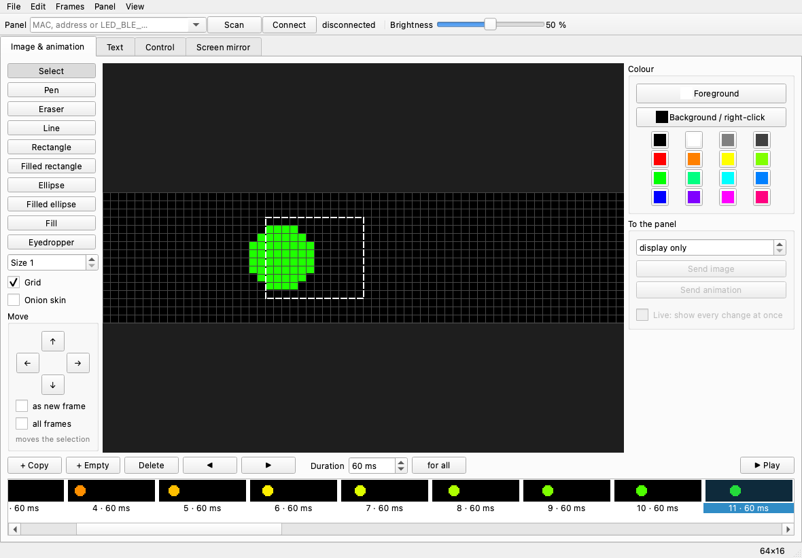
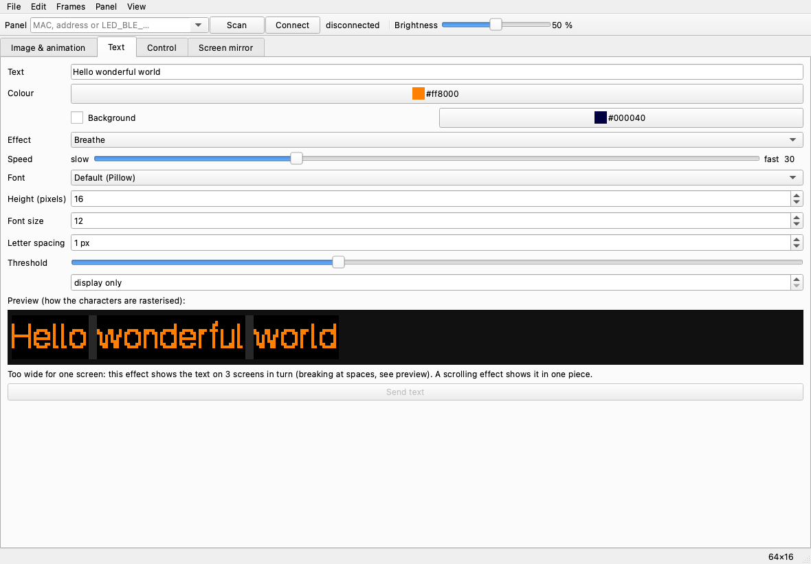
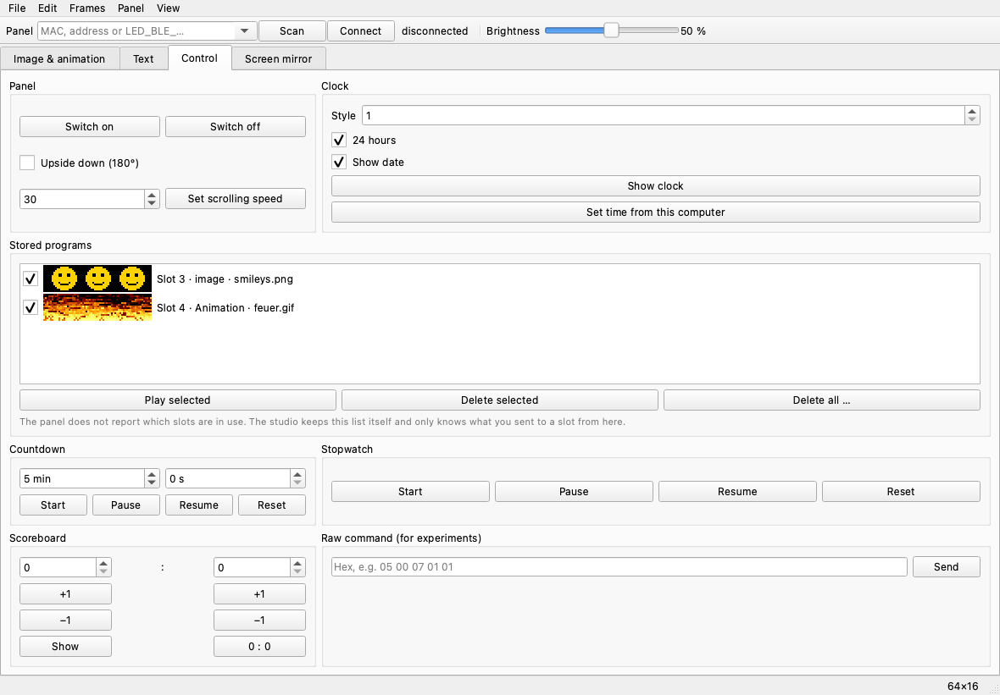
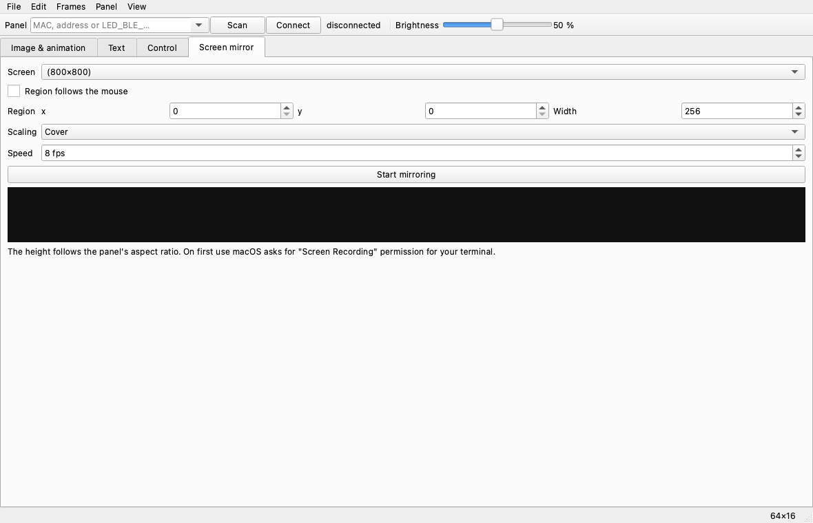

# ipixel

[](https://github.com/ninharp/ipixel_qt/actions/workflows/tests.yml)

Python library, CLI and desktop app (iPixel Studio) for LED matrix panels made for the
"iPixel Color" app (`com.wifiled.ipixels`), which advertise over BLE as `LED_BLE_xxxxxxxx`.
The protocol was reconstructed from APK v3.8.1.

## Platform support

| | macOS | Linux | Windows |
|---|---|---|---|
| Library and CLI | tested on a real panel | expected to work, not yet tested | expected to work, not yet tested |
| iPixel Studio | tested on a real panel | expected to work, not yet tested | expected to work, not yet tested |
| Screen mirror | works (needs permission) | X11 only (Wayland returns black frames) | expected to work |

Bluetooth goes through [bleak](https://github.com/hbldh/bleak) (CoreBluetooth, BlueZ, WinRT)
and the desktop app through Qt (PySide6), both cross-platform. You need a Bluetooth LE adapter
and Python 3.11 or newer. The test suite (protocol, rendering, editor and the studio UI without
a screen) runs on Linux, Windows and macOS in CI; Bluetooth itself can only be tested with a
panel. Reports from Linux and Windows are welcome.

## Installation

With [uv](https://docs.astral.sh/uv/) (recommended), this installs the `ipixel` and
`ipixel-studio` commands:

```bash
uv tool install "ipixel[studio] @ git+https://github.com/ninharp/ipixel_qt"
```

Leave out `[studio]` if you only want the library and CLI. With pip, inside a virtual
environment:

```bash
python -m venv .venv
source .venv/bin/activate          # Windows: .venv\Scripts\activate
pip install "ipixel[studio] @ git+https://github.com/ninharp/ipixel_qt"
```

From a checkout, for development:

```bash
git clone https://github.com/ninharp/ipixel_qt && cd ipixel_qt
uv sync --extra studio
uv run pytest
uv run ipixel-studio
```

### macOS

- The terminal (or app) that starts `ipixel` needs Bluetooth permission: System Settings →
  Privacy & Security → Bluetooth. Without it Python aborts as soon as it touches Bluetooth.
- macOS hides MAC addresses. A MAC given as target is therefore also matched by the advertised
  name `LED_BLE_` + last four MAC bytes (logged as a warning, since names can be spoofed).
- Screen mirror needs Screen Recording permission for the same terminal.

### Linux

- BlueZ must be running (`systemctl status bluetooth`), and your user needs access to it
  (on most desktops this works out of the box; otherwise add yourself to the `bluetooth` group).
- Qt needs a few system libraries for its window; on Debian/Ubuntu:
  `sudo apt install libxcb-cursor0 libegl1`.
- Panel passwords are kept in the Secret Service keyring (GNOME Keyring, KWallet). Without one
  the studio asks again each session.
- Screen mirror only captures on X11.

### Windows

- Windows 10 (1809) or newer with Bluetooth switched on. Do not pair the panel in the Windows
  settings; the app connects directly.
- Use the commands in PowerShell or cmd; `ipixel-studio` starts without a console window.

## Command line

```bash
ipixel scan
export IPIXEL_DEVICE=50:28:13:54:ED:F4   # MAC, BLE address or LED_BLE_ name (Windows: set IPIXEL_DEVICE=...)
ipixel info                           # size, type, vendor IDs, supported screens
ipixel brightness 40
ipixel text "Hello world" --color ff8000 --effect scroll_left --speed 60
ipixel image photo.jpg --fit cover
ipixel gif cat.gif
ipixel frame picture.png              # live frame (raw RGB, not stored)
ipixel clock --style 2
ipixel gif cat.gif --slot 2           # store as program 2 instead of only showing it
ipixel play 1 2                       # play stored programs 1 and 2 in rotation
ipixel delete 2                       # delete stored program 2
ipixel raw "05000780 01"              # send any frame and print the reply
```

Add `-v` for progress, `-vv` for every frame sent and received.

## Python API

```python
import asyncio
from ipixel import IPixel, TextEffect

async def main():
    async with IPixel("50:28:13:54:ED:F4") as px:
        print(px.info)               # type, size, block size
        await px.brightness(60)
        await px.text("Hi", color=(0, 255, 0), effect=TextEffect.BLINK)
        await px.image("logo.png", slot=1)   # store in program slot 1

asyncio.run(main())
```

## iPixel Studio (desktop app)

```bash
ipixel-studio
```

Enter the panel's MAC (or scan for it) and click Connect. The user interface is available in English and German. It follows the system language on first
start and can be switched under View → Language / Sprache (the app offers to restart).

- **Image & animation:** pixel editor at panel size (select, pen, eraser, line, rectangle,
  ellipse, fill, eyedropper; right-click paints with the background colour). Select a region and
  drag it, cut/copy/paste it (also to and from other programs) or clear it. Arrow keys and the
  arrow buttons move the selection, or the whole frame with wrap-around when nothing is
  selected (Shift: 4 pixels); "as new frame" appends a shifted copy per step, so a scrolling
  animation takes a few clicks, and "all frames" moves the whole animation. Frames with individual
  durations, onion skin, preview playback, undo/redo. Opens PNG/GIF/JPEG, saves losslessly as
  (A)PNG, exports GIF. Sends a single image (PNG) or the animation (GIF), either display-only or
  stored in slot 1–99. **Live:** every edit and the playing preview appear on the panel at once.
- **Text:** system fonts, row height, font size, letter spacing, threshold, colour, background,
  effect, speed (0 slow … 100 fast, default 30), raster preview. Shows whether the text fits the
  panel: static effects (fixed, blink, breathe, …) show wider text screen by screen, breaking at
  spaces; the scrolling effects run it through.
- **Control:** power, rotate 180°, clock, set time, countdown, stopwatch, scoreboard, raw
  commands with their reply, and the list of **stored programs**: everything you send to a slot
  (1–99) appears there with a thumbnail; tick programs to play them in rotation or delete them.
  The panel cannot report its slots, so the studio keeps this list itself, per panel.
- **Screen mirror:** streams a screen region (fixed or around the mouse pointer) live to the panel.



| Text | Control | Screen mirror |
|---|---|---|
|  |  |  |

German UI: [editor](docs/screenshots/editor.png), [text](docs/screenshots/text.png),
[control](docs/screenshots/steuerung.png), [screen mirror](docs/screenshots/spiegeln.png).

## Example animations

[`examples/animations/`](examples/animations) has 64×16 animations generated by
[`examples/make_animations.py`](examples/make_animations.py): fire, plasma, rainbow wave, matrix
rain, starfield, Pac-Man, beating hearts, equalizer, fireworks, red scanner, snake and a smiley
still. They loop seamlessly: periodic effects use whole periods per loop, and the random fire is
cut where a frame nearly repeats an earlier one (the studio's "find best cut" tool does the same
for your own animations).

```bash
ipixel gif examples/animations/feuer.gif
uv run python examples/make_animations.py /tmp/my-animations   # regenerate elsewhere
```

GIFs sent to the panel are written with full frames and colour tables the firmware decodes:
one shared table up to 256 colours, otherwise per-frame tables that are never larger than the
global one (a larger local table makes the panel skip those frames).

## Other panel sizes

The library and the studio are not tied to 64×16. On connect the panel reports its type
(byte 4 of the info reply); that determines the size, the upload block size and whether the
text header needs three extra border bytes. The known sizes are the same as in the phone app:

| Type | Size | Type | Size | Type | Size |
|---|---|---|---|---|---|
| 0x80 / 0x00 | 64×64 | 0x8a | 64×32 | 0x94 | 16×16 |
| 0x81 | 32×32 | 0x8b, 0x8d | 96×32 | 0x95 | 64×64 |
| 0x82 | 32×16 | 0x8c, 0x86 | 128×32 | 0x96 | 96×64 |
| 0x83 | 64×16 | 0x8e | 160×32 | 0x97 | 128×64 |
| 0x84 | 96×16 | 0x8f | 192×32 | 0x98 | 160×64 |
| 0x85 | 64×20 | 0x90 | 256×32 | 0x99 | 192×64 |
| 0x87 | 144×16 | 0x91 | 320×32 | 0x9a | 256×64 |
| 0x88 | 192×16 | 0x92 | 384×32 | 0x9b | 320×64 |
| 0x89 | 48×24 | 0x93 | 448×32 | 0x9c | 384×64 |

Not every panel has every screen. The advertisement carries vendor IDs (manufacturer `0x5254`,
data `00 72 <cid:2> <pid>`); like the vendor app, the studio greys out countdown, stopwatch and
scoreboard where that model does not offer them (e.g. the 64×16 panel with cid `0007`, pid `04`
ignores those commands). `ipixel info` prints the IDs and the resulting features.

Only 64×16 (0x83) has been tested so far. If a panel reports an unknown type, set the size by
hand in the studio under Edit → Change panel size.

## Protocol

GATT: service `0x00FA`, write `0xFA02` (with response, at most 509 bytes per write after
MTU 512), replies as notifications on the notify characteristic of the same service (`0xFA03`).

Every frame: `len:u16le` (including these two bytes) · `cmd:2` · payload.

| Command | Frame |
|---|---|
| Power | `05 00 07 01 <0/1>` |
| Brightness 0–100 | `05 00 04 80 <n>` |
| Rotate 180° | `05 00 06 80 <0/1>` |
| Info + set time | `08 00 01 80 HH MM SS <lang>` → reply byte 4 = type byte, byte 10 = password enabled |
| Clock | `0b 00 06 01 <style> <12h?> <date?> YY MM DD WD` |
| Scrolling text speed | `05 00 03 01 <n>` |
| Delete everything | `04 00 03 80` |
| Delete slots | `len 02 01 <count:u16le> <slots…>` |
| Play slots in rotation | `len 08 80 <count:u16le> <slots…>` |
| Countdown | `07 00 0d 80 <action> <min> <sec>` (0 reset, 1 start, 2 pause, 3 resume) |
| Stopwatch | `05 00 09 80 <action>` (same as countdown) |
| Scoreboard | `08 00 0a 80 <left:u16le> <right:u16le>` |
| Verify password | `07 00 05 02 <aa> <bb> <cc>` (digit pairs as decimal bytes) |

Uploads (PNG `02 00`, GIF `03 00`, text `00 01`) are sent in blocks of 12 KiB
(types 0x00/0x80/0x81) or 4 KiB (all others):

`len:u16le · cmd · opt(0 first, 2 following) · total:u32le · crc32(total):u32le · marker(02 for GIF, else 00) · slot · data`

Slot 1.. stores the content as a program, 101 only displays it. After each block the panel
acknowledges with `05 00 <cmd> <status>`: 1 = block ok, 3 = done, 0 = CRC error, 2 = rejected.

Live RGB (`00 00`): `len · 00 00 · opt · frame_size:u32le · R,G,B…` without CRC. It is only
shown in DIY mode: send `05 00 04 01 01` first (enter and clear; 3 = enter without clearing),
afterwards `… 02` (leave, keep the image) or `… 00` (leave, back to the previous program). The
panel acknowledges live frames with status 1, not 3. As frame size the app sends 4096 or 12288
rather than the data length; that works on the 64×16 panel.

Text payload: 14-byte header (`count:u16le, h-align, v-align, effect, speed, 1, R,G,B,
bg?, R,G,B`, plus 3 border bytes on the long 32/64-row panels), then per character
`80 R G B width height` + a 1-bit bitmap (rows padded to 8 bits, LSB first).
Effects: 0 fixed, 1 left, 2 right, 3 up, 4 down, 5 blink, 6 breathe, 7 snowflakes, 8 laser.
Speed: 0 slow … 100 fast (the vendor app starts at 65–80).

Static effects page the text by **glyph count**, not by pixels: the vendor app sends every Latin
character as a fixed half-height-wide glyph (8 px at 16 rows), so the 64×16 panel shows 8 glyphs
per screen however narrow they are. The library therefore merges each screen's characters into a
single wide glyph (the width byte allows up to 255 px), which fills the screen and keeps the
effect. Scrolling effects get one glyph per character, like the vendor app.

## Credits

- The Android app "iPixel Color" 3.8.1 was analysed with the **REA** reverse-engineering
  toolkit and decompiled with [jadx](https://github.com/skylot/jadx); protocol details were then
  checked frame by frame against a real 64×16 panel.
- Library, CLI, iPixel Studio and this documentation were written with the help of
  **Claude** (Anthropic), using Claude Code.
- Not affiliated with the makers of the iPixel Color app or the panels.
