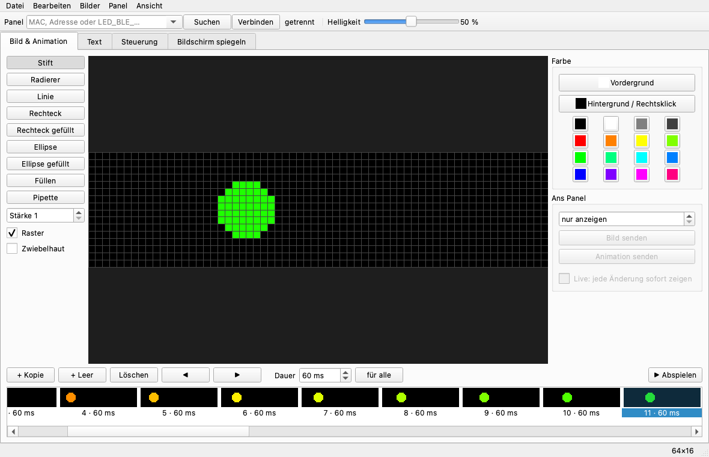
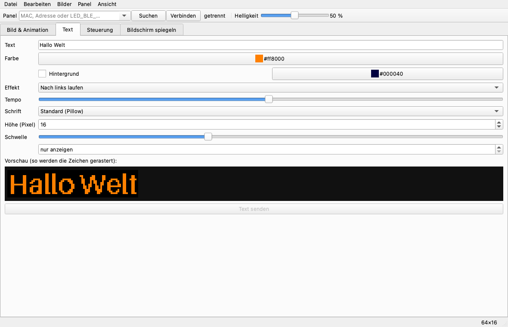
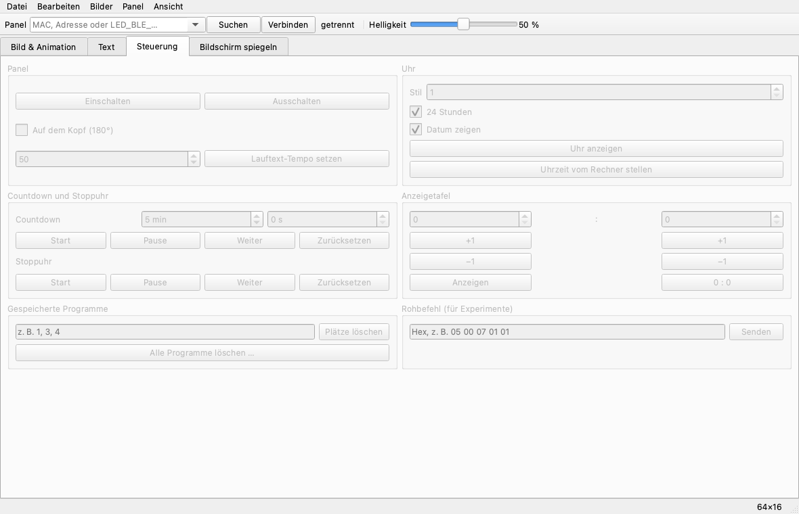
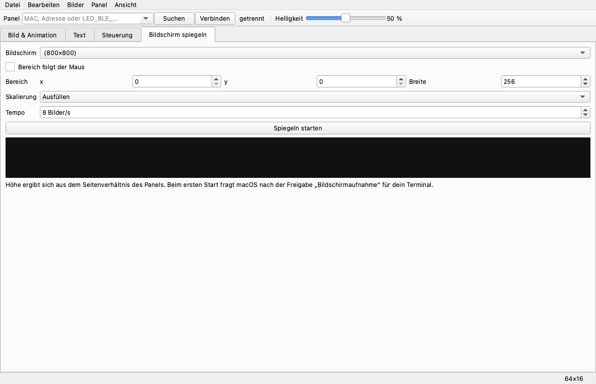

# ipixel

Python-Library und CLI für LED-Matrix-Panels der App „iPixel Color“ (`com.wifiled.ipixels`),
die per BLE als `LED_BLE_xxxxxxxx` werben. Protokoll aus der APK v3.8.1 rekonstruiert.

```bash
uv sync
uv run ipixel scan
export IPIXEL_DEVICE=50:28:13:54:ED:F4   # MAC, BLE-Adresse oder LED_BLE_-Name
uv run ipixel info
uv run ipixel brightness 40
uv run ipixel text "Hallo Welt" --color ff8000 --effect scroll_left --speed 60
uv run ipixel image foto.jpg --fit cover
uv run ipixel gif katze.gif
uv run ipixel frame bild.png          # Live-Bild (rohes RGB, nicht gespeichert)
uv run ipixel clock --style 2
uv run ipixel raw "05000780 01"       # beliebigen Rahmen senden, Antwort ausgeben
```

```python
import asyncio
from ipixel import IPixel, TextEffect

async def main():
    async with IPixel("50:28:13:54:ED:F4") as px:
        print(px.info)               # Typ, Größe, Blockgröße
        await px.brightness(60)
        await px.text("Hi", color=(0, 255, 0), effect=TextEffect.BLINK)
        await px.image("logo.png", slot=1)   # in Programmplatz 1 speichern

asyncio.run(main())
```

## iPixel Studio (Desktop-App)

```bash
uv sync --extra studio
uv run ipixel-studio        # aus dem Terminal starten, das die Bluetooth-Freigabe hat
```

- **Bild & Animation:** Pixel-Editor in Panelgröße (Stift, Radierer, Linie, Rechteck, Ellipse,
  Füllen, Pipette, Rechtsklick malt mit Hintergrundfarbe), Bilder mit eigener Dauer, Zwiebelhaut,
  Vorschau abspielen, Rückgängig. Öffnet PNG/GIF/JPEG, speichert verlustfrei als (A)PNG,
  exportiert GIF. Senden als Bild (PNG) oder Animation (GIF), nur anzeigen oder auf Platz 1–99.
  **Live:** jede Änderung und die abgespielte Vorschau sofort aufs Panel.
- **Text:** Systemschriften, Höhe, Schwelle, Farbe, Hintergrund, Effekt, Tempo, Rastervorschau.
- **Steuerung:** An/Aus, Drehen, Uhr, Uhrzeit stellen, Countdown, Stoppuhr, Anzeigetafel,
  Plätze löschen, Rohbefehle mit Antwort.
- **Bildschirm spiegeln:** Bildschirmbereich (fest oder um den Mauszeiger) live aufs Panel.



| Text | Steuerung | Bildschirm spiegeln |
|---|---|---|
|  |  |  |

## Andere Panelgrößen

Library und Studio sind nicht auf 64×16 festgelegt. Beim Verbinden meldet das Panel seinen
Typ (Byte 4 der Infoantwort), daraus ergeben sich Größe, Blockgröße und ob der Textkopf drei
zusätzliche Rahmen-Bytes braucht. Bekannt sind dieselben Größen wie in der Handy-App:

| Typ | Größe | Typ | Größe | Typ | Größe |
|---|---|---|---|---|---|
| 0x80 / 0x00 | 64×64 | 0x8a | 64×32 | 0x94 | 16×16 |
| 0x81 | 32×32 | 0x8b, 0x8d | 96×32 | 0x95 | 64×64 |
| 0x82 | 32×16 | 0x8c, 0x86 | 128×32 | 0x96 | 96×64 |
| 0x83 | 64×16 | 0x8e | 160×32 | 0x97 | 128×64 |
| 0x84 | 96×16 | 0x8f | 192×32 | 0x98 | 160×64 |
| 0x85 | 64×20 | 0x90 | 256×32 | 0x99 | 192×64 |
| 0x87 | 144×16 | 0x91 | 320×32 | 0x9a | 256×64 |
| 0x88 | 192×16 | 0x92 | 384×32 | 0x9b | 320×64 |
| 0x89 | 48×24 | 0x93 | 448×32 | 0x9c | 384×64 |

Getestet ist bisher nur 64×16 (0x83). Meldet ein Panel einen unbekannten Typ, lässt sich die
Größe im Studio unter „Bearbeiten → Panelgröße ändern“ von Hand setzen.

Auf macOS ist die MAC nicht sichtbar; eine MAC wird deshalb auch über den Namen
`LED_BLE_` + letzte vier MAC-Bytes gefunden. Python braucht dort die Bluetooth-Freigabe
des Terminals.

## Protokoll

GATT: Service `0x00FA`, Schreiben `0xFA02` (mit Antwort, max. 509 Byte je Write nach
MTU 512), Antworten per Notify auf der Notify-Characteristic desselben Services.

Jeder Rahmen: `len:u16le` (inklusive dieser zwei Bytes) · `cmd:2` · Nutzdaten.

| Befehl | Rahmen |
|---|---|
| An/Aus | `05 00 07 01 <0/1>` |
| Helligkeit 0–100 | `05 00 04 80 <n>` |
| Spiegeln | `05 00 06 80 <0/1>` |
| Info + Uhrzeit setzen | `08 00 01 80 HH MM SS <lang>` → Antwort Byte 4 = Typ (0x80+Index), Byte 10 = Passwort aktiv |
| Uhr | `0b 00 06 01 <stil> <12h?> <datum?> YY MM DD WD` |
| Lauftext-Tempo | `05 00 03 01 <n>` |
| Alles löschen | `04 00 03 80` |
| Plätze löschen | `len 02 01 <anz:u16le> <plätze…>` |
| Countdown | `07 00 0d 80 <aktion> <min> <sek>` (0 zurück, 1 Start, 2 Pause, 3 weiter) |
| Stoppuhr | `05 00 09 80 <aktion>` (wie Countdown) |
| Anzeigetafel | `08 00 0a 80 <links:u16le> <rechts:u16le>` |
| Passwort prüfen | `07 00 05 02 <aa> <bb> <cc>` (Ziffernpaare dezimal) |

Uploads (PNG `02 00`, GIF `03 00`, Text `00 01`) werden in Blöcken zu 12 KiB
(Typ 0x80/0x81) bzw. 4 KiB gesendet:

`len:u16le · cmd · opt(0 erster, 2 folgende) · gesamt:u32le · crc32(gesamt):u32le · marker(02 bei GIF, sonst 00) · platz · daten`

Platz 1.. speichert als Programm, 101 zeigt nur an. Nach jedem Block quittiert das Panel mit
`05 00 <cmd> <status>`: 1 = Block ok, 3 = fertig, 0 = CRC-Fehler, 2 = abgelehnt.

Live-RGB (`00 00`): `len · 00 00 · opt · rahmengröße:u32le · R,G,B…` ohne CRC. Wird nur im
DIY-Modus angezeigt: vorher `05 00 04 01 01` (betreten, leeren; 3 = ohne Leeren), danach
`… 02` (verlassen, Bild bleibt) bzw. `… 00` (verlassen, vorheriges Programm). Das Panel
quittiert Live-Bilder mit Status 1, nicht 3. Als Rahmengröße schickt die App 4096 bzw. 12288,
nicht die Datenlänge; so funktioniert es am 64×16-Panel.

Text-Nutzdaten: 14 Byte Kopf (`anzahl:u16le, h-ausr., v-ausr., effekt, tempo, 1, R,G,B,
hg?, R,G,B`, bei langen 32/64-Zeilen-Panels + 3 Rahmen-Bytes), dann je Zeichen
`80 R G B breite höhe` + 1-Bit-Bitmap (Zeilen auf 8 Bit aufgefüllt, LSB zuerst).
Effekte: 0 fest, 1 links, 2 rechts, 3 hoch, 4 runter, 5 blinken, 6 atmen, 7 Schnee, 8 Laser.
